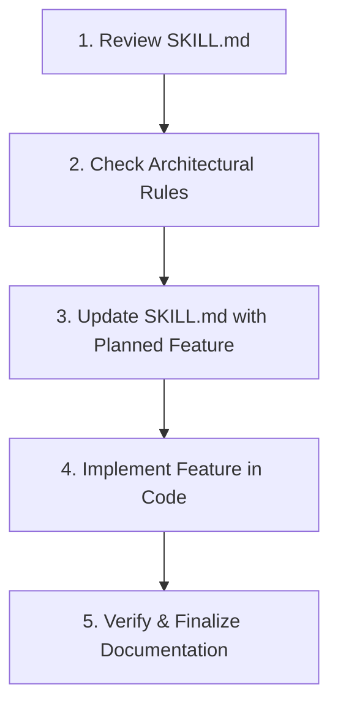

# CrevoSys 2.0 — Project Reference & Engineering Skill Guide

> **MANDATORY PROTOCOL — READ & UPDATE BEFORE EVERY FEATURE:**
> Before developing or modifying any feature, route, model, or component in this repository:
> 1. **Consult this document** to ensure alignment with our established tech stack, design aesthetic, and architectural decisions.
> 2. **Update this document** (specifically the *Decisions*, *Completed Features*, or *Roadmap* sections) to record the feature being introduced or modified.
> 3. Never introduce divergent UI patterns, unapproved packages, or unauthenticated admin surfaces.

---

## 1. What the Project Is For (Mission & Scope)

**CrevoSys 2.0** (`crevosys-official/crevosys_2.0`) is the official flagship web application and digital command platform for **CrevoSys**, an elite digital craftsmanship agency.

### Core Agency Offerings
- **Full-Stack Software Development**: Custom high-performance web applications, enterprise software, and mobile apps.
- **UI/UX Design Systems**: Bespoke design systems, interaction design, micro-interactions, and Figma-to-code workflows.
- **AI Workflow Automation**: AI agent architecture, workflow integrations, LLM pipelines, and process optimization.
- **Digital Marketing & Growth**: Performance marketing, brand strategy, technical SEO, and conversion optimization.

### Target Experience & Audience
- **Luxury Dark Aesthetic**: Cinematic obsidian/zinc visual hierarchy, atmospheric glow blurs, 3D kinetic typography, and fluid GSAP/Framer Motion animations.
- **Client Conversion Engine**: High-impact interactive sections, stacked project showcases, and a streamlined contact pipeline backed by Resend.
- **Back-Office Operations**: A protected administrative workspace (`/admin`) for managing live client inquiries, projects, services, team members, tech tools, and testimonials.

---

## 2. Technology Stack & Ecosystem

| Category | Technology & Version | Purpose in CrevoSys 2.0 |
| :--- | :--- | :--- |
| **Framework** | **Next.js 15.3.6** (App Router) | Server Components (RSC), Client Components, Serverless Route Handlers (`src/app/api`), dynamic routing. |
| **Runtime & Language** | **Node.js** (v18+/v20+), **TypeScript 6.0.3** | Strict type safety, clean interfaces, and modern ES module support. |
| **UI Library** | **React 19.0.0** & **React DOM 19** | Component architecture, React 19 hooks, client-side interactivity. |
| **Styling** | **Tailwind CSS v4** (`@tailwindcss/postcss`, `@import "tailwindcss"`) | Utility-first styling with modern CSS `@custom-variant dark`, `oklch` theme tokens, and `tw-animate-css`. |
| **Custom Typography** | **HeadingNow** (variants 55, 56, 57 `.woff2`), Google Fonts | Brand headline display (`HeadingNow`, `Bebas Neue`, `Anton`) and readable body copy (`Inter Tight`). |
| **Motion & Animation** | **GSAP 3.13.0** (`@gsap/react`), **Framer Motion 12.23.0** | 3D kinetic text staggers, scroll-triggered reveals, interactive modals, and floating cursor dynamics. |
| **Smooth Scrolling** | **Lenis 1.3.4** (`@studio-freight/lenis`) | Inertial smooth scrolling integrated via `ReactLenis` and `ScrollProvider`. |
| **Database & ODM** | **MongoDB Atlas** via **Mongoose 9.10.3** | Scalable database layer with global singleton cached connection (`src/lib/mongodb.ts`). |
| **Authentication & Security** | Custom **Crypto HMAC-SHA256 OTP** + **jose 6.2.12** | 2-Minute time-bound 6-digit OTP challenge tokens sent via Resend for zero-password admin protection (`src/lib/adminAuth.ts`). |
| **Email Service** | **Resend 6.12.3** | Automated contact form inquiry dispatch and admin OTP verification emails. |
| **Media Cloud Storage** | **Cloudinary 2.11.0** / **next-cloudinary 6.19.3** | Dynamic image uploads and CDN-delivered media optimization (`/api/upload`). |
| **UI Primitives & Notifications** | **Radix UI Slot**, **Lucide React 0.525.0**, **Sonner 2.0.6** | Accessible UI primitives, consistent icon set, and non-blocking toast notifications. |
| **Hosting & Deployment** | **Vercel** | Edge-ready serverless hosting, Vercel OIDC integration, and automated CI/CD. |

---

## 3. What Has Already Been Decided (Architecture & Conventions)

### 3.1 Design System & Aesthetic Decisions
- **Dark-Only Luxury Theme**: Base background color is pure pitch black (`#000000`, `#050508`) complemented by deep indigo glows (`#221f35`, `indigo-600/[0.05]`) and CrevoSys signature neon orange highlights (`#ff6a00`).
- **Ambient Radial Gradient**: Fixed background ambient layer using `/gradient.webp` with controlled opacity (`opacity-10`) to provide unified atmospheric depth across all pages.
- **Interactive Custom Cursor**: Dynamic cursor (`CustomCursor.tsx`) with contextual hover variants (`hero`, `about`, `testimonials`, `plan`, `design`, `build`) that reacts to user focus.
- **Fluid Lenis Scrolling**: All public routes run through `ScrollProvider` with Lenis inertial scrolling enabled, while preventing scroll jumps during modal interactions.

### 3.2 Directory & Code Architecture
- `src/app/`: Next.js App Router for all public pages, service routes, admin dashboard, and `/api` route handlers.
- `src/components/`:
  - `layout/`: Global elements (`Navbar`, `Footer`, `CustomCursor`, `ScrollToTop`).
  - `sections/`: High-level page sections (`Hero`, `Services`, `Projects`, `TeamSquadSection`, `Faq`, `GetTouch`, etc.).
  - `admin/`: Back-office components, navigation sidebar, overview widgets, and auth guards.
  - `ui/`: Shared atomic UI elements (Radix buttons, Sonner toaster).
- `src/models/`: Strongly typed Mongoose schemas for MongoDB entities (`Project`, `Service`, `Team`, `Feedback`, `Tool`).
- `src/lib/`: Reusable singletons and utilities (`mongodb.ts`, `adminAuth.ts`, `cloudinary.ts`, `lenis.ts`, `utils.ts`).
- `src/data/`: Default fallback JSON/TypeScript data (`defaultServices`, `defaultTeam`, `defaultTools`, `defaultFeedback`, `projects.json`) ensuring full UI resilience even when the database is cold or unseeded.

### 3.3 Security & Admin Decisions
- **No Stored Plaintext Admin Passwords**: Admin access is governed by 2FA OTP codes generated on demand and sent to `crevosysofficial@gmail.com`.
- **HMAC Signed Challenge Tokens**: OTP challenges expire strictly in 120 seconds (`OTP_EXPIRY_SECONDS = 120`) and are signed using `ADMIN_AUTH_SECRET` (falling back to `RESEND_API_KEY`).
- **Protected Client Workspace**: `/admin/*` routes are unconditionally gated by `<AdminGuard>` and render `<AdminLockScreen>` until the session is authenticated.

### 3.4 Data Resilience Pattern
- Every API endpoint that serves public data (services, tools, team, feedbacks, projects) must query MongoDB first. If the database is empty or unavailable, it automatically falls back to seeded static data from `src/data/` without breaking the UI.

---

## 4. What Already Added Completely (Completed Inventory)

### 4.1 Public Routes & Pages
- **Homepage (`/`)**:
  - `Hero.tsx`: GSAP-animated headline reveal, interactive buttons, 3D depth, responsive layout.
  - `Services.tsx`: Interactive service overview cards with hover transitions and link-outs.
  - `technology.tsx` (Integrations): Dynamic categorized tech stack grid with interactive tool badges.
  - `Projects.tsx`: Sticky stacked cards showcase for portfolio projects with live tags and `ProjectModal.tsx`.
  - `Testimonials.tsx`: Animated client reviews carousel with verified badge and avatars.
  - `Progress.tsx`: 3-phase execution roadmap ("Plan", "Design", "Build") with custom cursor interactions.
  - `Faq.tsx`: Expandable FAQ accordion with smooth spring animations.
  - `GetTouch.tsx`: High-conversion footer CTA section with magnetic contact button.
- **About Page (`/about`)**:
  - Full company origin story, core leadership showcase, dynamic impact metrics, company vision & values, and interactive squad spotlight (`TeamSquadSection.tsx`).
- **Team Page (`/team`)**:
  - Dedicated team directory layout (`TeamLayout.tsx`) presenting squad members, specializations, and social profiles.
- **Contact Page (`/contact`)**:
  - Complete inquiry submission form connected to Resend API (`/api/contact`), company coordinates, and ambient starry visual effects (`/pricing/stars.svg`).
- **Services Deep-Dive Hub & Routes**:
  - `/services`: Main agency services catalog.
  - `/services/development`: Full-stack engineering, web & mobile architecture.
  - `/services/design`: UI/UX design systems, prototypes, and branding.
  - `/services/automation`: AI workflow automation, LLMs, and RPA.
  - `/services/marketing`: Performance marketing, analytics, and growth strategies.
  - `/services/[service]`: Dynamic slug-based service route template.
- **Works Redirect (`/works`)**:
  - Server-side redirect to `/#portfolio`.
- **iOS & Mobile WebKit Stabilization**:
  - Global `ignoreMobileResize: true` on ScrollTrigger preventing infinite resize layout thrashing caused by mobile address bar collapse.
  - Responsive Lenis controller (`src/lib/lenis.tsx`) with `syncTouch: false`, zero touch hijacking on iOS/Android, and deleted shadowing `lenis.ts`.
  - Next.js `RootLayout` DOM hierarchy fix ensuring `<ReactLenis>` resides strictly inside `<body>`.
  - Viewport optimization removing `maximumScale: 1, userScalable: false` for uninhibited iOS pull-to-refresh and native gestures.
- **Error & Utility Pages**:
  - Custom 404 (`not-found.tsx`), Error handler (`error.tsx`), Root boundary (`global-error.tsx`).
  - Automated SEO assets: `sitemap.ts`, `robots.ts`, OpenGraph (`opengraph-image.jpg`), and Twitter preview (`twitter-image.jpg`).

### 4.2 Admin Panel & Back-Office (`/admin`)
- **Admin Authentication**:
  - Lockscreen modal (`AdminLockScreen.tsx`) requesting OTP dispatch.
  - Two-Factor OTP challenge generation and verification (`/api/admin/auth`).
  - Session guardian wrapper (`AdminGuard.tsx`) with auto-lock timer.
- **Admin Dashboard Overview (`/admin/page.tsx`)**:
  - GSAP staggered entry animations.
  - `DashboardHeaderBar.tsx`: Welcome banner, quick action triggers, live system status.
  - `OverviewKpiRow.tsx`: KPI metrics (Total Projects, Active Inquiries, Team Count, System Uptime).
  - `RunningProjectProgression.tsx`: Live delivery milestones and project status progress bars.
  - `CrashAnalysis.tsx` & `SystemHealthAndActivity.tsx`: System telemetry and health indicators.
  - `FeedbackAndProductsTable.tsx`: Recent client reviews and product delivery logs.
  - `TeamLiveTrackingSidebar.tsx`: Squad availability and active task statuses.
  - `UpcomingMeetingsSchedule.tsx`: Calendar of upcoming client consultations.
  - `ReliabilityGaugeCard.tsx` & `AiAssistantCard.tsx`: Infrastructure uptime score and AI assistant card.
- **Admin Management Modules**:
  - `/admin/projects`: Project portfolio CRUD interface.
  - `/admin/services`: Service offerings and pricing tier management.
  - `/admin/teams`: Team member profile and roster manager.
  - `/admin/tools`: Tech stack directory and integrations management.
  - `/admin/feedbacks`: Client testimonials moderation and review manager.

### 4.3 Database Schemas & Models (`src/models/`)
- `Project.ts`: Title, slug, description, category, client, thumbnail, images, liveUrl, githubUrl, featured flag, order.
- `Service.ts`: Title, slug, tag, icon, description, longDescription, features, deliverables, order, active flag.
- `Team.ts`: Name, role, designation, avatar, bio, skills, socialLinks (GitHub, LinkedIn, Twitter, Portfolio), order.
- `Feedback.ts`: Client name, role, company, avatar, comment, rating, projectTitle, featured flag.
- `Tool.ts`: Name, category (Frontend, Backend, Design, AI, DevOps), iconUrl, description, proficiency, order.

### 4.4 API Endpoints (`src/app/api/`)
- `POST /api/contact`: Validates and sends user inquiry emails via Resend.
- `POST /api/admin/auth`: Dispatches 6-digit OTP codes and validates challenge tokens.
- `GET, POST, PUT, DELETE /api/projects`: Project database CRUD.
- `GET, POST, PUT, DELETE /api/services`: Service catalog CRUD.
- `GET, POST, PUT, DELETE /api/teams`: Team member roster CRUD.
- `GET, POST, PUT, DELETE /api/tools`: Tech stack items CRUD.
- `GET, POST, PUT, DELETE /api/feedbacks`: Testimonial and feedback CRUD.
- `POST /api/upload`: Direct media upload handler to Cloudinary CDN.
- `GET /api/db-test`: Health check endpoint testing MongoDB connection.

---

## 5. Feature Development Protocol (Update Before Every Feature)

Whenever you prepare to implement a new feature or modify an existing one, follow this exact 5-step checklist:

1. **Step 1 — Review `SKILL.md`**: Verify existing components, data models, and conventions to avoid duplicate work or incompatible patterns.
2. **Step 2 — Verify Stack Compliance**: Use Tailwind CSS v4, Lucide icons, Sonner toasts, and GSAP/Framer Motion. Do not install redundant libraries.
3. **Step 3 — Update `SKILL.md` Before Writing Code**:
   - Add the planned feature under **Section 6 (Feature Roadmap & In-Progress Work)** with status `[IN PROGRESS]`.
   - Record any new database model fields, route names, or architectural decisions.
4. **Step 4 — Implement the Feature**: Write clean, modular, and type-safe TypeScript code. Ensure responsive design and luxury dark theme adherence.
5. **Step 5 — Move to Completed Inventory**: Once built, tested, and validated, move the feature from *In-Progress* to *Section 4 (Completed Features Inventory)*.

---

## 6. Feature Roadmap & In-Progress Work

| Feature / Task | Target Route / Component | Status | Key Details & Dependencies |
| :--- | :--- | :--- | :--- |
| *Active feature tracking placeholder* | *e.g., Blog or Client Portal* | `[PLANNED]` | *Update this table prior to starting any new work.* |

---

*Last Updated: 2026-10-25 | Maintained by the CrevoSys Core Engineering Team*
