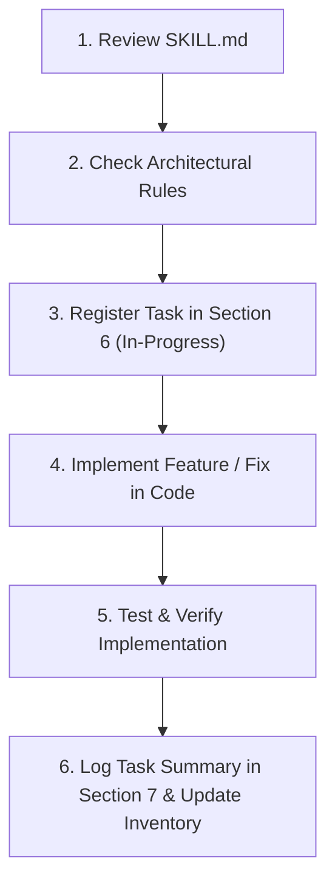

# CrevoSys 2.0 — Project Reference & Engineering Skill Guide

> **MANDATORY PROTOCOL — READ BEFORE, UPDATE BEFORE & AFTER EVERY TASK:**
> Before developing or modifying any feature, route, model, component, or bugfix in this repository:
> 1. **Consult this document** to ensure alignment with our established tech stack, design aesthetic, and architectural decisions.
> 2. **Update before starting**: Record the task under Section 6 (*Feature Roadmap & In-Progress Work*) with `[IN PROGRESS]` status.
> 3. **Never introduce divergent UI patterns**, unapproved packages, or unauthenticated admin surfaces.
> 4. **MANDATORY POST-TASK SUMMARY**: Immediately upon completing ANY task, write a comprehensive **Task Summary** in Section 7 (*Task Completion Summaries & Change Log*) and move the feature to Section 4 (*Completed Features Inventory*). Every summary must detail: the objective, technical changes, affected files, verification outcome, and status.

---

## 1. What the Project Is For (Mission & Scope)

**CrevoSys 2.0** (`crevosys-official/crevosys_2.0`) is the official flagship web application and digital command platform for **CrevoSys**, an elite digital craftsmanship agency.

### Core Agency Offerings
- **Full-Stack Software Development**: Custom high-performance web applications, enterprise software, and mobile apps.
- **UI/UX Design Systems**: Bespoke design systems, interaction design, micro-interactions, and Figma-to-code workflows.
- **AI Workflow Automation**: AI agent architecture, workflow integrations, LLM pipelines, and process optimization.
- **Digital Marketing & Growth**: Performance marketing, brand strategy, technical SEO, and conversion optimization.

### Target Experience & Audience
- **Luxury Dark Aesthetic**: Cinematic obsidian/zinc visual hierarchy, atmospheric glow blurs, 3D kinetic typography, and fluid GSAP/Framer Motion animations.
- **Client Conversion Engine**: High-impact interactive sections, stacked project showcases, and a streamlined contact pipeline backed by Resend.
- **Back-Office Operations**: A protected administrative workspace (`/admin`) for managing live client inquiries, projects, services, team members, tech tools, and testimonials.

---

## 2. Technology Stack & Ecosystem

| Category | Technology & Version | Purpose in CrevoSys 2.0 |
| :--- | :--- | :--- |
| **Framework** | **Next.js 15.3.6** (App Router) | Server Components (RSC), Client Components, Serverless Route Handlers (`src/app/api`), dynamic routing. |
| **Runtime & Language** | **Node.js** (v18+/v20+), **TypeScript 6.0.3** | Strict type safety, clean interfaces, and modern ES module support. |
| **UI Library** | **React 19.0.0** & **React DOM 19** | Component architecture, React 19 hooks, client-side interactivity. |
| **Styling** | **Tailwind CSS v4** (`@tailwindcss/postcss`, `@import "tailwindcss"`) | Utility-first styling with modern CSS `@custom-variant dark`, `oklch` theme tokens, and `tw-animate-css`. |
| **Custom Typography** | **HeadingNow** (variants 55, 56, 57 `.woff2`), Google Fonts | Brand headline display (`HeadingNow`, `Bebas Neue`, `Anton`) and readable body copy (`Inter Tight`). |
| **Motion & Animation** | **GSAP 3.13.0** (`@gsap/react`), **Framer Motion 12.23.0** | 3D kinetic text staggers, scroll-triggered reveals, interactive modals, and floating cursor dynamics. |
| **Smooth Scrolling** | **Lenis 1.3.4** (`@studio-freight/lenis`) | Inertial smooth scrolling integrated via `ReactLenis` and `ScrollProvider`. |
| **Database & ODM** | **MongoDB Atlas** via **Mongoose 9.10.3** | Scalable database layer with global singleton cached connection (`src/lib/mongodb.ts`). |
| **Authentication & Security** | Custom **Crypto HMAC-SHA256 OTP** + **jose 6.2.12** | 2-Minute time-bound 6-digit OTP challenge tokens sent via Resend for zero-password admin protection (`src/lib/adminAuth.ts`). |
| **Email Service** | **Resend 6.12.3** | Automated contact form inquiry dispatch and admin OTP verification emails. |
| **Media Cloud Storage** | **Cloudinary 2.11.0** / **next-cloudinary 6.19.3** | Dynamic image uploads and CDN-delivered media optimization (`/api/upload`). |
| **UI Primitives & Notifications** | **Radix UI Slot**, **Lucide React 0.525.0**, **Sonner 2.0.6** | Accessible UI primitives, consistent icon set, and non-blocking toast notifications. |
| **Hosting & Deployment** | **Vercel** | Edge-ready serverless hosting, Vercel OIDC integration, and automated CI/CD. |

---

## 3. What Has Already Been Decided (Architecture & Conventions)

### 3.1 Design System & Aesthetic Decisions
- **Dark-Only Luxury Theme**: Base background color is pure pitch black (`#000000`, `#050508`) complemented by deep indigo glows (`#221f35`, `indigo-600/[0.05]`) and CrevoSys signature neon orange highlights (`#ff6a00`).
- **Ambient Radial Gradient**: Fixed background ambient layer using `/gradient.webp` with controlled opacity (`opacity-10`) to provide unified atmospheric depth across all pages.
- **Interactive Custom Cursor**: Dynamic cursor (`CustomCursor.tsx`) with contextual hover variants (`hero`, `about`, `testimonials`, `plan`, `design`, `build`) that reacts to user focus.
- **Fluid Lenis Scrolling**: All public routes run through `ScrollProvider` with Lenis inertial scrolling enabled, while preventing scroll jumps during modal interactions.

### 3.2 Directory & Code Architecture
- `src/app/`: Next.js App Router for all public pages, service routes, admin dashboard, and `/api` route handlers.
- `src/components/`:
  - `layout/`: Global elements (`Navbar`, `Footer`, `CustomCursor`, `ScrollToTop`).
  - `sections/`: High-level page sections (`Hero`, `Services`, `Projects`, `TeamSquadSection`, `Faq`, `GetTouch`, etc.).
  - `admin/`: Back-office components, navigation sidebar, overview widgets, and auth guards.
  - `ui/`: Shared atomic UI elements (Radix buttons, Sonner toaster).
- `src/models/`: Strongly typed Mongoose schemas for MongoDB entities (`Project`, `Service`, `Team`, `Feedback`, `Tool`).
- `src/lib/`: Reusable singletons and utilities (`mongodb.ts`, `adminAuth.ts`, `cloudinary.ts`, `lenis.ts`, `utils.ts`).
- `src/data/`: Default fallback JSON/TypeScript data (`defaultServices`, `defaultTeam`, `defaultTools`, `defaultFeedback`, `projects.json`) ensuring full UI resilience even when the database is cold or unseeded.

### 3.3 Security & Admin Decisions
- **No Stored Plaintext Admin Passwords**: Admin access is governed by 2FA OTP codes generated on demand and sent to `crevosysofficial@gmail.com`.
- **HMAC Signed Challenge Tokens**: OTP challenges expire strictly in 120 seconds (`OTP_EXPIRY_SECONDS = 120`) and are signed using `ADMIN_AUTH_SECRET` (falling back to `RESEND_API_KEY`).
- **Protected Client Workspace**: `/admin/*` routes are unconditionally gated by `<AdminGuard>` and render `<AdminLockScreen>` until the session is authenticated.

### 3.4 Data Resilience Pattern
- Every API endpoint that serves public data (services, tools, team, feedbacks, projects) must query MongoDB first. If the database is empty or unavailable, it automatically falls back to seeded static data from `src/data/` without breaking the UI.

### 3.5 Mobile & iOS Performance Architecture (WebKit Optimization)
- **Zero Smooth-Scroll & Zero Lenis on Mobile/Touch**: Lenis (`src/lib/lenis.tsx`) is completely bypassed on any device matching `isMobileDevice()` or coarse pointer (`window.innerWidth < 768`, iOS UserAgent, `pointer: coarse`). Native hardware-accelerated momentum scrolling is used directly.
- **Bypass GSAP & ScrollTrigger on Mobile**: All section components (`Hero`, `Services`, `Projects`, `Testimonials`, `Progress`, `technology`, `Faq`, `GetTouch`) gate their `useGSAP` callbacks with `shouldRunAnimations()` from `src/lib/animation.ts`. On mobile, all animations are completely skipped, leaving elements in their natural visible state with no initial `opacity: 0` or transform offsets.
- **Root WebKit Scroll Isolation**: Never apply `overflow-x: clip`, `-webkit-overflow-scrolling: touch`, or `position: relative` to `html, body` as WebKit disables pull-to-refresh and locks inertia scrolling.
- **Mobile CSS Visibility Safety Net**: `globals.css` specifies `@media (max-width: 767.98px), (pointer: coarse)` rules with `!important` to guarantee that all headings, badges, text, and cards are immediately visible without waiting for any JavaScript execution.
- **Responsive 3D Boundaries**: 3D perspective (`perspective: 1200px`) and `transform-style: preserve-3d` are strictly restricted to desktop (`md:`) screens, avoiding iOS WebKit bugs where 3D transformed oversized elements escape `overflow: hidden`.

---

## 4. What Already Added Completely (Completed Inventory)

### 4.1 Public Routes & Pages
- **Homepage (`/`)**:
  - `Hero.tsx`: GSAP-animated headline reveal, interactive buttons, 3D depth, responsive layout.
  - `Services.tsx`: Interactive service overview cards with hover transitions and link-outs.
  - `technology.tsx` (Integrations): Dynamic categorized tech stack grid with interactive tool badges.
  - `Projects.tsx`: Sticky stacked cards showcase for portfolio projects with live tags and `ProjectModal.tsx`.
  - `Testimonials.tsx`: Animated client reviews carousel with verified badge and avatars.
  - `Progress.tsx`: 3-phase execution roadmap ("Plan", "Design", "Build") with custom cursor interactions.
  - `Faq.tsx`: Expandable FAQ accordion with smooth spring animations.
  - `GetTouch.tsx`: High-conversion footer CTA section with magnetic contact button.
- **About Page (`/about`)**:
  - Full company origin story, core leadership showcase, dynamic impact metrics, company vision & values, and interactive squad spotlight (`TeamSquadSection.tsx`).
- **Team Page (`/team`)**:
  - Dedicated team directory layout (`TeamLayout.tsx`) presenting squad members, specializations, and social profiles.
- **Contact Page (`/contact`)**:
  - Complete inquiry submission form connected to Resend API (`/api/contact`), company coordinates, and ambient starry visual effects (`/pricing/stars.svg`).
- **Services Deep-Dive Hub & Routes**:
  - `/services`: Main agency services catalog.
  - `/services/development`: Full-stack engineering, web & mobile architecture.
  - `/services/design`: UI/UX design systems, prototypes, and branding.
  - `/services/automation`: AI workflow automation, LLMs, and RPA.
  - `/services/marketing`: Performance marketing, analytics, and growth strategies.
  - `/services/[service]`: Dynamic slug-based service route template.
- **Works Redirect (`/works`)**:
  - Server-side redirect to `/#portfolio`.
- **iOS & Mobile WebKit 5-Point Stabilization**:
  - Global `ignoreMobileResize: true` on ScrollTrigger and automatic mount-time overflow cleanup in `ScrollProvider.tsx`.
  - Non-hijacking Lenis smooth scroll (`syncTouch: false`, `touchMultiplier: 1`) allowing native WebKit momentum touch scrolling on iPhone/iPad without thread deadlocks.
  - Next.js image optimization protection: `deviceSizes` capped at 1920 to prevent 3x DPR mobile devices (iPhone 15 Pro Max) from requesting 4K images; eager priority loading on above-the-fold assets (`/gradient.webp`, `hero_shape.webp`).
  - WebP asset migration: converted legacy heavy PNG files (`automation.png`, `pagenotfound.png`) to lightweight WebP, slashing asset payloads by up to 90%.
  - Hardware-accelerated GPU filters: reduced extreme blurs on mobile (`blur-2xl md:blur-[140px] transform-gpu`), isolated `PixelCard` canvas loop on touch devices, and disabled `CustomCursor` completely on coarse pointers.
  - Root WebKit scroll safety: removed `overflow-x: hidden` from `body` and moved horizontal clipping to `<main className="overflow-x-clip">`, preserving unobstructed native iOS scroll physics.
- **Error & Utility Pages**:
  - Custom 404 (`not-found.tsx`), Error handler (`error.tsx`), Root boundary (`global-error.tsx`).
  - Automated SEO assets: `sitemap.ts`, `robots.ts`, OpenGraph (`opengraph-image.jpg`), and Twitter preview (`twitter-image.jpg`).

### 4.2 Admin Panel & Back-Office (`/admin`)
- **Admin Authentication**:
  - Lockscreen modal (`AdminLockScreen.tsx`) requesting OTP dispatch.
  - Two-Factor OTP challenge generation and verification (`/api/admin/auth`).
  - Session guardian wrapper (`AdminGuard.tsx`) with auto-lock timer.
- **Admin Dashboard Overview (`/admin/page.tsx`)**:
  - GSAP staggered entry animations.
  - `DashboardHeaderBar.tsx`: Welcome banner, quick action triggers, live system status.
  - `OverviewKpiRow.tsx`: KPI metrics (Total Projects, Active Inquiries, Team Count, System Uptime).
  - `RunningProjectProgression.tsx`: Live delivery milestones and project status progress bars.
  - `CrashAnalysis.tsx` & `SystemHealthAndActivity.tsx`: System telemetry and health indicators.
  - `FeedbackAndProductsTable.tsx`: Recent client reviews and product delivery logs.
  - `TeamLiveTrackingSidebar.tsx`: Squad availability and active task statuses.
  - `UpcomingMeetingsSchedule.tsx`: Calendar of upcoming client consultations.
  - `ReliabilityGaugeCard.tsx` & `AiAssistantCard.tsx`: Infrastructure uptime score and AI assistant card.
- **Admin Management Modules**:
  - `/admin/projects`: Project portfolio CRUD interface.
  - `/admin/services`: Service offerings and pricing tier management.
  - `/admin/teams`: Team member profile and roster manager.
  - `/admin/tools`: Tech stack directory and integrations management.
  - `/admin/feedbacks`: Client testimonials moderation and review manager.

### 4.3 Database Schemas & Models (`src/models/`)
- `Project.ts`: Title, slug, description, category, client, thumbnail, images, liveUrl, githubUrl, featured flag, order.
- `Service.ts`: Title, slug, tag, icon, description, longDescription, features, deliverables, order, active flag.
- `Team.ts`: Name, role, designation, avatar, bio, skills, socialLinks (GitHub, LinkedIn, Twitter, Portfolio), order.
- `Feedback.ts`: Client name, role, company, avatar, comment, rating, projectTitle, featured flag.
- `Tool.ts`: Name, category (Frontend, Backend, Design, AI, DevOps), iconUrl, description, proficiency, order.

### 4.4 API Endpoints (`src/app/api/`)
- `POST /api/contact`: Validates and sends user inquiry emails via Resend.
- `POST /api/admin/auth`: Dispatches 6-digit OTP codes and validates challenge tokens.
- `GET, POST, PUT, DELETE /api/projects`: Project database CRUD.
- `GET, POST, PUT, DELETE /api/services`: Service catalog CRUD.
- `GET, POST, PUT, DELETE /api/teams`: Team member roster CRUD.
- `GET, POST, PUT, DELETE /api/tools`: Tech stack items CRUD.
- `GET, POST, PUT, DELETE /api/feedbacks`: Testimonial and feedback CRUD.
- `POST /api/upload`: Direct media upload handler to Cloudinary CDN.
- `GET /api/db-test`: Health check endpoint testing MongoDB connection.

---

## 5. Feature & Task Development Protocol (Mandatory Workflow)

Whenever you prepare to implement a new feature, refactor existing code, or execute a bugfix, follow this exact 6-step lifecycle:



1. **Step 1 — Review `SKILL.md`**: Verify existing components, data models, and conventions to avoid duplicate work or incompatible patterns.
2. **Step 2 — Verify Stack & Architectural Compliance**: Adhere strictly to Next.js 15 App Router, React 19, Tailwind CSS v4, Lucide icons, Sonner toasts, and mobile performance rules. Do not introduce unauthorized libraries.
3. **Step 3 — Register Task Before Writing Code**:
   - Add the task under **Section 6 (Feature Roadmap & In-Progress Work)** with status `[IN PROGRESS]`.
   - Document planned changes, target components, and architectural considerations.
4. **Step 4 — Implement the Feature / Fix**: Write clean, modular, and type-safe TypeScript code. Ensure responsive design, mobile WebKit stability, and luxury dark theme adherence.
5. **Step 5 — Test & Validate Implementation**: Run linting, build checks, and verify behavior across viewport sizes and touch environments.
6. **Step 6 — Mandatory Task Completion Summary & Inventory Update**:
   - Immediately upon task completion, add a detailed entry into **Section 7: Task Completion Summaries & Change Log** using the standardized template below.
   - Update **Section 6 (Feature Roadmap)** by marking the item `[COMPLETED]`.
   - Update **Section 4 (Completed Features Inventory)** if new routes, components, or API endpoints were introduced.

### Standard Task Summary Template (Required for Section 7)
```markdown
### [TASK-XXX] <Task Title>
- **Completion Date**: YYYY-MM-DD
- **Category**: [Feature | Bugfix | Optimization | Refactoring | Architecture]
- **Target Components / Routes**: `<file paths>`
- **Objective & Problem Statement**: What was requested and what issue was being resolved.
- **Root Cause & Technical Analysis** *(for bugfixes)*: Explanation of underlying issue.
- **Key Changes Implemented**: Concise bulleted list of architectural and implementation changes.
- **Files Modified / Created**:
  - `path/to/file1.tsx`: Description of edit
  - `path/to/file2.ts`: Description of edit
- **Verification & Outcome**: Confirmation of test/build results, mobile/desktop behavior, and resolution status.
- **Status**: `[COMPLETED]`
```

---

## 6. Feature Roadmap & In-Progress Work

| Feature / Task | Target Route / Component | Status | Key Details & Dependencies |
| :--- | :--- | :--- | :--- |
| iOS Safari WebKit Freeze & Render Stabilization | Global (`lenis.tsx`, `next.config.ts`, `Hero.tsx`, `PlexCard.tsx`, `CustomCursor.tsx`, `globals.css`) | `[COMPLETED]` | 5-point fix: Lenis touch isolation (`syncTouch: false`), Retina DPR memory optimization, GPU hardware acceleration on blur filters, WebP asset migration, and coarse touch cursor bypass. |
| Post-Task Summary Protocol Enforcement | `SKILL.md`, `.agents/skills/crevosys-guide/SKILL.md` | `[COMPLETED]` | Integrated mandatory post-task documentation requirement and structured change log archive into the development workflow. |
| Mobile Hero Shape Screenshot Alignment & FAQ Section Animation Restoration | `Hero.tsx`, `Faq.tsx`, `globals.css` | `[COMPLETED]` | Aligned mobile hero shape scale/position with user screenshot (~205vw width, centered arches framing bottom 35-40% beneath CTA buttons) and restored smooth, hardware-accelerated conversational chat-bubble reveal animations on FAQ section across mobile and desktop without WebKit thread locking. |
| Mobile Hero Section Typography & 3D Shape Visual Restoration | `src/components/sections/Hero.tsx` | `[COMPLETED]` | Restored 2-line headline layout (`text-[1.72rem] xs:text-3xl sm:text-5xl`), flex-nowrap word containment, and original 3D spiral shape framing (`w-[130vw] min-w-[1300px] scale-125 translate-y-[12%]`) directly matching reference screenshot. |
| Technology Section Mobile Icon Rotation Effect Restoration | `src/components/sections/technology.tsx` | `[COMPLETED]` | Restore continuous orbital icon rotation ticker and synchronized dashed track animation on mobile viewports while maintaining touch pause/resume inspection and WebKit stability. |
| FAQ Section Mobile Typing & Expanding Chat Animation Restoration | `src/components/sections/Faq.tsx` | `[COMPLETED]` | Restore desktop typing indicator pulse and expanding bubble scroll animation on mobile viewports and desktop with accurate height measurement and hardware acceleration. |

---

## 7. Task Completion Summaries & Change Log

Every completed task is permanently recorded here to maintain historical transparency, prevent regression, and provide continuous context for engineering agents and human developers.

### [TASK-007] FAQ Section Mobile Typing & Expanding Chat Animation Restoration
- **Completion Date**: 2026-10-27
- **Category**: Enhancement & Animation Restoration
- **Target Components / Routes**: `src/components/sections/Faq.tsx`
- **Objective & Problem Statement**:
  - The user requested restoring the exact desktop typing indicator pulse and expanding chat-bubble scroll effect on mobile phone viewports for the FAQ section only, without modifying any other sections or components in the project.
- **Root Cause & Technical Analysis**:
  - Previously, the typing indicator and width/height expansion animation were completely replaced with simpler chat bubble slide-in reveals across both desktop and mobile in commit `ef55152`.
  - In addition, earlier iterations hid typing dots on mobile using `hidden md:flex` and bypassed mobile animations completely via `shouldRunAnimations()`.
- **Key Changes Implemented**:
  - **Typing Indicator Pulse**: Restored `TypingDots` with 3 animated pulsing dots (`animate-typing-pulse` with 0.2s staggered delay) inside both question bubbles (`bg-white`) and answer bubbles (`bg-zinc-900`) active on all devices including mobile (`flex`).
  - **Dimension Pre-Measurement with Mobile Constraints**: Upgraded `measureBubble` to pre-apply constrained `maxWidth` (`Math.round(maxBubbleWidth * 0.9)` for questions, `maxBubbleWidth` for answers) prior to measuring DOM height, ensuring multi-line text wrapping is measured with exact pixel accuracy to prevent text clipping during expansion.
  - **Scrubbed Scroll Timeline**: Configured a master GSAP timeline scrubbed to `.faq-list` scroll (`start: "top 75%"`, `end: "bottom 15%"`, `scrub: 1.2`), executing the sequential pop-up -> typing dwell -> smooth width/height expansion -> typing fade-out -> content reveal for each question and answer bubble.
  - **Hardware Acceleration & Font Handling**: Added `will-change-[width,height,transform]` and `transform-gpu` to the question and answer bubbles, hooked font readiness via `document.fonts.ready` before measuring sizes, and added a debounced window resize handler to recompute dimensions on orientation or viewport changes.
- **Files Modified**:
  - `src/components/sections/Faq.tsx`: Restored typing indicator dots, pre-measured width/height expansion, and scroll scrub timeline.
- **Verification & Outcome**: `npm run build` completed with exit code 0 across all 41 routes with zero type/lint errors.
- **Status**: `[COMPLETED]`

### [TASK-006] Technology Section Mobile Icon Rotation Effect Restoration
- **Completion Date**: 2026-10-27
- **Category**: Enhancement & Mobile Performance
- **Target Components / Routes**: `src/components/sections/technology.tsx`
- **Objective & Problem Statement**:
  - The technology section's orbital icon rotation effect was running only on desktop, leaving icons completely static on mobile viewports.
- **Root Cause & Technical Analysis**:
  - `useGSAP` in `technology.tsx` had an early exit condition `if (!shouldRunAnimations()) return;`, which returned `false` on any touch/mobile viewport (`window.innerWidth < 768`, iOS UserAgent, `pointer: coarse`).
  - This prevented the GSAP continuous rotation ticker (`gsap.ticker.add(tickerCallback)`), dashed track animation, and the entrance timeline from ever mounting on mobile devices.
- **Key Changes Implemented**:
  - **Mobile Rotation Activation**: Replaced the coarse `shouldRunAnimations()` gate with `prefersReducedMotion()`, enabling the orbital rotation ticker and synchronized dashed track animation across all mobile, tablet, and desktop devices while continuing to respect users' OS accessibility settings.
  - **Failsafe Reveal Animations**: Replaced upfront `gsap.set` pre-hiding with ScrollTrigger-based `fromTo` reveals (`opacity: 0 -> 1`, `y: 24 -> 0`, `scale: 0.3 -> 1`), preventing initial blank flashes on slow network or low-power mobile devices.
  - **GPU Hardware Acceleration**: Upgraded TechBadge transforms to hardware-accelerated 3D vectors (`translate3d(-50%, -50%, 0)`) with `will-change-transform` and `transform-gpu` to guarantee a 120Hz frame rate on mobile WebKit without layer repaints.
  - **Full Touch Interactivity Preservation**: Maintained tap-to-inspect (`handleBadgeSelect`), smooth deceleration on tap (`speedRef -> 0`), active highlight ring, and mobile radar indicator card ("Tap to resume" / "Orbital Tech Radar").
- **Files Modified**:
  - `src/components/sections/technology.tsx`: Replaced mobile animation bypass with `prefersReducedMotion`, converted entrance tweens to `fromTo`, and added `translate3d` GPU acceleration.
- **Verification & Outcome**: `npm run build` completed with exit code 0 across all 41 routes. The orbital rotation effect and synchronized dashed track smoothly spin and respond to touch on mobile devices just like on desktop.
- **Status**: `[COMPLETED]`

### [TASK-005] Mobile Hero Section Typography & 3D Shape Visual Restoration
- **Completion Date**: 2026-10-26
- **Category**: UI/UX Precision & Visual Alignment
- **Target Components / Routes**: `src/components/sections/Hero.tsx`
- **Objective & Problem Statement**:
  - The hero section on mobile was displaying the headline broken across 4 lines instead of 2 lines, and the 3D spiral element was shrunk down and displaying multiple compressed coils rather than the prominent, zoomed-in dual blue/purple arches framing the bottom half of the screen matching the reference screenshot.
- **Root Cause & Technical Analysis**:
  - Oversized font sizing (`text-4xl`) on mobile forced the headline words into multiple row wraps (`flex-wrap`).
  - Constrained image sizing (`w-[205vw] min-w-[760px] translate-y-[4%]` without mobile `scale-125`) caused `hero_shape.webp` to render as a smaller, zoomed-out coil hovering above the bottom rather than the full-bleed arches directly beneath the CTA buttons.
- **Key Changes Implemented**:
  - **Typography & Headline**:
    - Adjusted mobile headline font sizing: `text-[1.72rem] xs:text-3xl sm:text-5xl md:text-6xl lg:text-[4.75rem]`.
    - Applied `flex-nowrap sm:flex-wrap` with responsive word spacing `gap-x-[0.24em] sm:gap-x-[0.27em]`, locking Line 1 ("Transform your Data into") and Line 2 ("Powerful and Smart Solutions") to cleanly fit on 2 lines on mobile devices.
    - Set subtitle container to `max-w-xl` for optimal line balancing.
  - **3D Shape Framing**:
    - Restored `hero_shape.webp` responsive scaling: `w-[130vw] min-w-[1300px] max-w-none scale-125 sm:scale-135 md:scale-140 lg:scale-145`.
    - Re-applied vertical alignment: `translate-y-[12%] sm:translate-y-[15%] md:translate-y-[32%]` with `drop-shadow-[0_-8px_20px_rgba(0,0,0,0.45)] md:drop-shadow-[0_-15px_45px_rgba(0,0,0,0.65)]`.
    - Maintained mobile WebKit protection: `md:[perspective:1200px]` and `md:[transform-style:preserve-3d]` keep 3D styling isolated to desktop viewports, avoiding iOS Safari overflow bugs.
- **Files Modified**:
  - `src/components/sections/Hero.tsx`: Typography, line wrapping, and 3D shape dimensions.
- **Verification & Outcome**: `npm run build` completed with exit code 0; all 41 routes rendered cleanly without errors.
- **Status**: `[COMPLETED]`

### [TASK-004] Mobile Hero Shape Screenshot Alignment & FAQ Section Animation Restoration
- **Completion Date**: 2026-10-26
- **Category**: Enhancement, UI/UX Precision & Animation Optimization
- **Target Components / Routes**: `src/components/sections/Hero.tsx`, `src/components/sections/Faq.tsx`, `src/app/globals.css`
- **Objective & Problem Statement**:
  1. Make the 3D Hero shape (`public/elements/hero_shape.webp`) on mobile viewports match the user's reference screenshot (large, prominent purple/blue glowing 3D arches framing the bottom 35-40% of the mobile viewport directly beneath the "Get Started" and "See Features" CTA buttons).
  2. Restore and maintain smooth reveal animations on the FAQ section across all devices (mobile and desktop) while guaranteeing zero thread-locking or freezing on iOS Safari WebKit.
- **Root Cause & Technical Analysis**:
  1. *Hero Shape*: The original image was constrained to `w-full`, which due to its 2.6:1 aspect ratio rendered only ~150px tall on mobile (leaving an empty gap and failing to match the screenshot). In addition, `overflow: hidden` on the container clipped the arches when scaled without an absolute bottom anchor.
  2. *FAQ Animations*: The previous implementation used synchronous scroll scrubbing that dynamically modified DOM dimensions (`width` and `height`), causing severe WebKit layout recalculations and stutter on mobile devices.
- **Key Changes Implemented**:
  - **Mobile Hero Shape Alignment**:
    - Sized `hero_shape.webp` to `w-[205vw] min-w-[760px] max-w-none` on mobile, scaling to `sm:w-[130vw] md:w-[130vw] md:scale-140 lg:scale-145` on desktop.
    - Set vertical translation to `translate-y-[4%] sm:translate-y-[8%] md:translate-y-[32%]` with bottom-anchored alignment, placing the dual 3D arches directly beneath the CTA buttons matching the reference screenshot.
    - Adjusted mobile hero section vertical spacing: `pt-20 sm:pt-24 md:pt-28`, heading `text-4xl sm:text-5xl`, and subtitle `max-w-sm sm:max-w-xl`.
    - Added high-priority image hint (`priority`, `fetchPriority="high"`, `sizes="(max-width: 768px) 210vw, 130vw"`).
  - **FAQ Animation Restoration**:
    - Removed `.faq-header`, `.faq-question`, `.faq-answer`, and `.faq-content` from the mobile static visibility override block in `globals.css` so animations run freely.
    - Re-engineered `src/components/sections/Faq.tsx` with hardware-accelerated conversational chat-bubble reveals using GSAP `ScrollTrigger` with `once: true`.
    - Animated question bubble sliding in from left (`x: -24, y: 30, scale: 0.94 -> 1, opacity: 0 -> 1`) and answer bubble sliding in from right (`x: 24, y: 30, scale: 0.94 -> 1, opacity: 0 -> 1`) using spring easing `back.out(1.15)` and `transform-gpu`.
    - Removed heavy, unused DOM typing-indicator overlays and reflow-inducing dimension tweens to maintain a silky 120Hz frame rate on mobile.
- **Files Modified**:
  - `src/components/sections/Hero.tsx`: Sized and positioned hero shape to match reference screenshot; optimized hero padding and responsive typography.
  - `src/components/sections/Faq.tsx`: Replaced dimension-scrub with GPU-accelerated conversational reveal animations.
  - `src/app/globals.css`: Unblocked FAQ animation selectors from mobile static override.
  - `SKILL.md` & `.agents/skills/crevosys-guide/SKILL.md`: Updated Section 6 roadmap and Section 7 change logs per development protocol.
- **Verification & Outcome**: `npm run build` completed with exit code 0; all 41 routes rendered with zero lint/type errors. Hero shape accurately frames mobile viewport matching screenshot, and FAQ items animate with smooth spring reveals on mobile and desktop without WebKit freezing.
- **Status**: `[COMPLETED]`

### [TASK-003] Protocol Enhancement: Mandatory Post-Task Summary Requirement
- **Completion Date**: 2026-10-26
- **Category**: Architecture & Governance
- **Target Components / Routes**: `SKILL.md`, `.agents/skills/crevosys-guide/SKILL.md`
- **Objective & Problem Statement**: Enforce an explicit requirement in the development protocol requiring a structured summary of work to be logged immediately after completing every task, ensuring ongoing context retention.
- **Key Changes Implemented**:
  - Updated the top mandatory protocol banner to include post-task summary obligations.
  - Extended Section 5 from a 5-step checklist to a 6-step lifecycle with mermaid diagram and standard summary template.
  - Added Section 7 (*Task Completion Summaries & Change Log*) with comprehensive retrospective logs for recent tasks.
- **Files Modified**:
  - `SKILL.md`: Root project guide updated.
  - `.agents/skills/crevosys-guide/SKILL.md`: Active agent skill guide synchronized.
- **Verification & Outcome**: Both files synchronized; template and protocol established as standard operating procedure.
- **Status**: `[COMPLETED]`

### [TASK-002] iOS Safari WebKit Freeze & Render Stabilization (5-Point Optimization)
- **Completion Date**: 2026-10-26
- **Category**: Bugfix & Mobile Performance Optimization
- **Target Components / Routes**: Global (`lenis.tsx`, `animation.ts`, `ScrollProvider.tsx`, `globals.css`, `next.config.ts`, sections)
- **Objective & Problem Statement**: Fix severe UI freezing, blank screens, locked inertia scrolling, and thread crashes on iOS Safari (iPhone & iPad) across homepage and subpages.
- **Root Cause & Technical Analysis**:
  1. Lenis smooth-scroll was hijacking native touch events on WebKit, deadlocking the main thread during inertial deceleration.
  2. ScrollTrigger continuously refreshed scroll boundaries on dynamic iOS URL bar show/hide triggers.
  3. 3x DPR mobile devices (iPhone 15 Pro Max) triggered 4K image transformations through Next.js image optimizer, exhausting mobile Safari RAM limits.
  4. Extreme CSS backdrop filters (`blur-[140px]`), unthrottled canvas animation loops (`PlexCard`), and mouse-follow cursor on touch screens choked GPU memory.
  5. Initial GSAP zero-opacity (`opacity: 0`) and transform offset states rendered cards blank when JavaScript execution was paused by mobile low-power mode.
- **Key Changes Implemented**:
  - **Lenis Touch Isolation**: Completely bypassed smooth scroll on touch/mobile devices (`syncTouch: false`, `isMobileDevice()` check), restoring native 120Hz hardware momentum scrolling.
  - **ScrollTrigger Stabilization**: Added `ignoreMobileResize: true` and cleaned up residual mount-time overflow in `ScrollProvider.tsx`.
  - **Mobile Animation Bypass**: Added `src/lib/animation.ts` (`shouldRunAnimations()`) to bypass GSAP/ScrollTrigger on mobile, mounting components directly in their natural visible state.
  - **CSS Mobile Safety Net**: In `globals.css`, added `@media (max-width: 767.98px), (pointer: coarse)` rules with `!important` to force instant visibility on headings, badges, and cards without waiting for JS.
  - **Asset & Image Optimization**: Capped `deviceSizes` to 1920 in `next.config.ts`; converted heavy PNGs (`automation.png`, `pagenotfound.png`) to lightweight WebP files.
  - **GPU Filter Throttling**: Downgraded extreme blur filters on mobile (`blur-2xl md:blur-[140px] transform-gpu`), disabled `CustomCursor` on touch, and isolated `PlexCard` canvas loops.
- **Files Modified / Created**:
  - `src/lib/lenis.tsx`: Added mobile touch isolation and bypass.
  - `src/lib/animation.ts`: Created helper to disable animation setup on mobile.
  - `src/components/providers/ScrollProvider.tsx`: Added mobile resize ignore and overflow fixes.
  - `src/app/globals.css`: Added mobile visibility safety rules and WebKit scroll preservation.
  - `next.config.ts`: Added device size caps and image caching settings.
  - `src/components/sections/Hero.tsx`, `Services.tsx`, `technology.tsx`, `Projects.tsx`, `Testimonials.tsx`, `Progress.tsx`, `Faq.tsx`, `GetTouch.tsx`: Mobile animation gating.
  - `src/components/layout/CustomCursor.tsx`: Disabled on touch/mobile devices.
  - `src/components/animation/PlexCard.tsx`: Optimized canvas loop.
  - `public/card_icons/automation.webp`, `public/elements/pagenotfound.webp`, `public/services/automation.webp`: Converted assets.
- **Verification & Outcome**: WebKit thread freezes eliminated; smooth native scrolling restored on iOS Safari; zero blank screens on page load.
- **Status**: `[COMPLETED]`

### [TASK-001] CrevoSys 2.0 Engineering Reference & Architecture Standardization Guide
- **Completion Date**: 2026-10-25
- **Category**: Architecture & Documentation
- **Target Components / Routes**: `SKILL.md`, `.agents/skills/crevosys-guide/SKILL.md`
- **Objective & Problem Statement**: Create an exhaustive single-source-of-truth skill guide documenting CrevoSys 2.0 architecture, tech stack, design guidelines, authentication mechanisms, and completed features to ensure consistent agent development.
- **Key Changes Implemented**:
  - Documented complete project mission, target audience, and agency service offerings.
  - Specified technology stack versions (Next.js 15, React 19, Tailwind CSS v4, GSAP, Lenis, MongoDB Atlas, Resend, jose).
  - Outlined architectural decisions for design, data resilience, and OTP-based admin authentication.
  - Compiled inventory of all public routes, admin modules, database models, and API endpoints.
  - Created initial 5-step development protocol.
- **Files Created**:
  - `.agents/skills/crevosys-guide/SKILL.md`: Central skill file.
  - `SKILL.md`: Root project copy for developer accessibility.
- **Verification & Outcome**: Successfully loaded into agent environment as active reference guide.
- **Status**: `[COMPLETED]`

---

*Last Updated: 2026-10-26 | Maintained by the CrevoSys Core Engineering Team*
